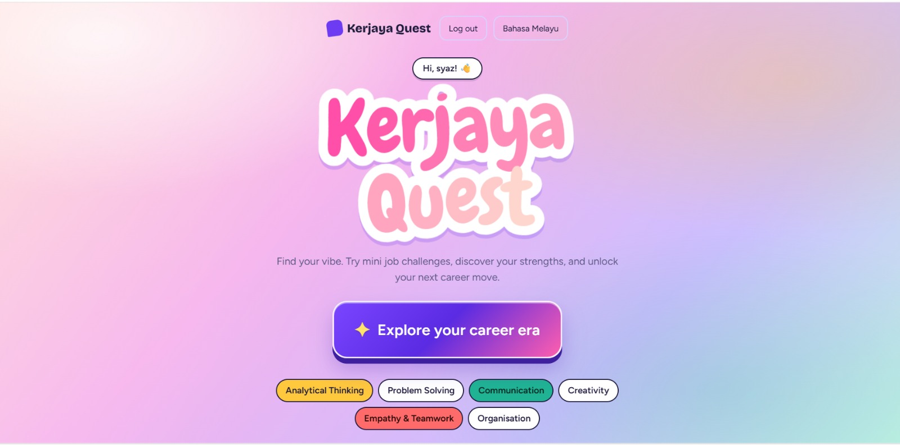

# CodeFest-26_WeCooked

# KerjayaQuest — Discover Your Skills, Explore Your Future

## KerjayaQuest Website Link

https://zuhayra1010.github.io/CodeFest-26_WeCooked/

## About the Project

KerjayaQuest is an interactive career exploration website designed to help students discover their strengths and explore potential career paths through short, job-related challenges.

Rather than relying solely on career quizzes, interests or academic results, students respond to realistic, workplace-inspired scenarios. Their answers receive feedback and skill scores, helping them better understand their abilities and discover careers that may suit them.

## Problem Statement

Many students struggle to choose a career because they may not fully understand their strengths or what different jobs involve.

Traditional career guidance often relies on interests, academic results and self-reported preferences, which may not fully reflect how students approach real-world situations.

KerjayaQuest addresses this challenge by allowing students to explore career-related scenarios, evaluate their responses and discover potential career paths based on their demonstrated skills.

## Target Users

- Secondary school students exploring future career options.
- College and university students who are uncertain about their career direction.
- Students who want to understand their strengths and explore different professions.

## Key Features

- **Interactive Career Challenges:** Complete 12 short, multiple-choice quests inspired by real-world jobs and everyday situations.
- **Skill Discovery:** Explore six key skills: analytical thinking, problem-solving, communication, creativity, empathy and teamwork, and organisation.
- **Personalised Career Recommendations:** View the top three career matches based on skill scores generated from completed challenges.
- **Career Card:** View a personalised results card featuring a matching career, strengths and skill scores.
- **Skill Passport:** Review completed quest results, individual scores and an overall breakdown of demonstrated skills.
- **Bilingual Interface:** Switch between English and Bahasa Melayu.
- **Login and Registration Demo:** Sign up or log in to access the career challenges, with a demo account available for testing.

## How It Works

1. **Sign In:** Log in or create a demo account to access the challenges.
2. **Choose a Challenge:** Begin a career-related quest.
3. **Answer the Scenario:** Select a response to a realistic job-related situation.
4. **Receive Feedback:** View your score, feedback and an explanation of the recommended response.
5. **Discover Your Career Matches:** Complete all 12 quests to generate your Career Card and view your top three career matches.
6. **Explore Your Skill Passport:** Review your quest results and skill breakdown, then identify areas for further development.

## Innovation

KerjayaQuest promotes experiential career exploration through realistic, job-inspired scenarios rather than relying solely on self-reported interests or traditional career quizzes.

By evaluating how students respond to different situations, the website provides immediate feedback, highlights potential strengths and connects skill scores to relevant career paths.

Its colourful interface, gamified challenges and bilingual support make career exploration more accessible and engaging for students.

## Technologies Used

- **Frontend:** HTML5, CSS3 and JavaScript
- **Browser Storage:** LocalStorage for demo account and session data
- **Web API:** Web Crypto API for password hashing where supported
- **Development Tools:** Visual Studio Code, Git and GitHub

**Note:** The current version uses browser-based demo authentication and does not include a backend server or external database.

## Future Improvements

- Develop a secure backend authentication system.
- Integrate a database for persistent user accounts and progress tracking.
- Save Skill Passport results so students can revisit their progress across sessions and devices.
- Add more challenges across different career fields.
- Improve career recommendations using more detailed skill assessments.
- Suggest learning activities to help students develop weaker skills.
- Expand the Skill Passport with achievements, milestones and progress reports.
- Introduce more interactive, hands-on job simulations.
